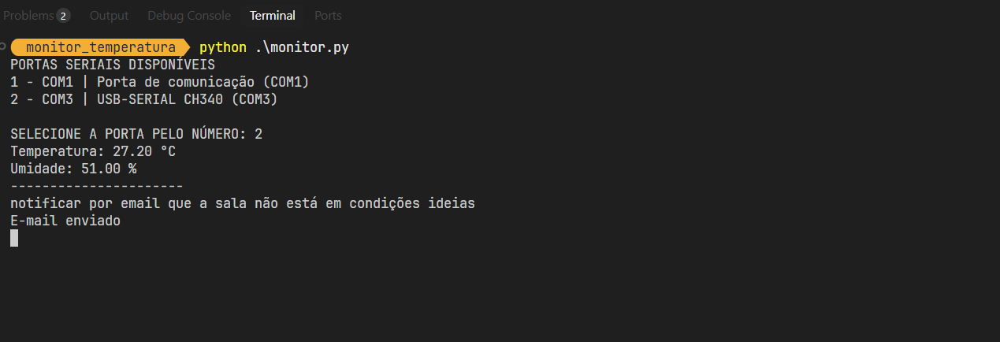
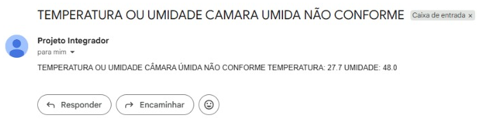

# Sensor de temperatura e umidade

> Descrição curta: software que detecta o Arduino e exibe a temperatura atual e manda para seu email.


## Integrantes

- RONAN ROCHA DE SOUZA
- VITOR GUILHERME DOS SANTOS ROCHA
- NAPOLEÃO SILVA ALVES
- REYLSON ANDRADE

## Sobre

Esse software tem como objetivo ler a temperatura e umidade via arduino (Apenas testado com arduino uno)

Ao ser aberto, o software:

1. Exibe as portas COM disponíveis;
2. Seleciona a porta COM;
3. Lê o sensor de temperatura;
4. Manda a temperatura atual para o email.

## Funcionalidades

- [x] Detecção do Arduino
- [x] Leitura da temperatura e umidade atual
- [x] Envio para o email

## Requisitos

### Hardware

- Arduino UNO
- Sensor de temperatura DHT11
- Cabo USB
- Jumpers

### Software

- Python
- API mailersend, serial e dotEnv
- Vs code e Arduino UNO
- pyinstaller

## Configuração

1. Porta serial selecionavel via menu console
2. API key salva do [MailSender](https://www.mailersend.com/) na ENV

```
MAILERSEND_API_KEY= SUA CHAVE DE API

EMAIL_DESTINATARIO= EMAIL QUE VAI RECEBER AS NOTIFICAÇÕES

NOME_DESTINATARIO= NOME DA PESSOA QUE VAI RECEBER AS NOTIFICAÇÕES
```

## Instalação

```bash
# Clonar o repositório
git clone https://github.com/RonanRocha/monitor_temperatura.git
cd monitor_temperatura

# Instalar dependências
pip install -r requirements.txt

#configurar variaveis de ambiente

renomear arquivo .env-example para .env e colocar suas chaves de api e outras configurações

```

## Como Usar

```bash
#entrar no diretorio do projeto e executar:

cd monitor_temperatura
python monitor.py
```

Saída esperada:

```
Temperatura: XX °C
Umidade: XX.XX %
```

## Gerar executavel

```bash
# gerar exe
pyinstaller monitor.spec

```

## Exemplos:

<h3>Terminal<h3>



<h3>Email</h3>


